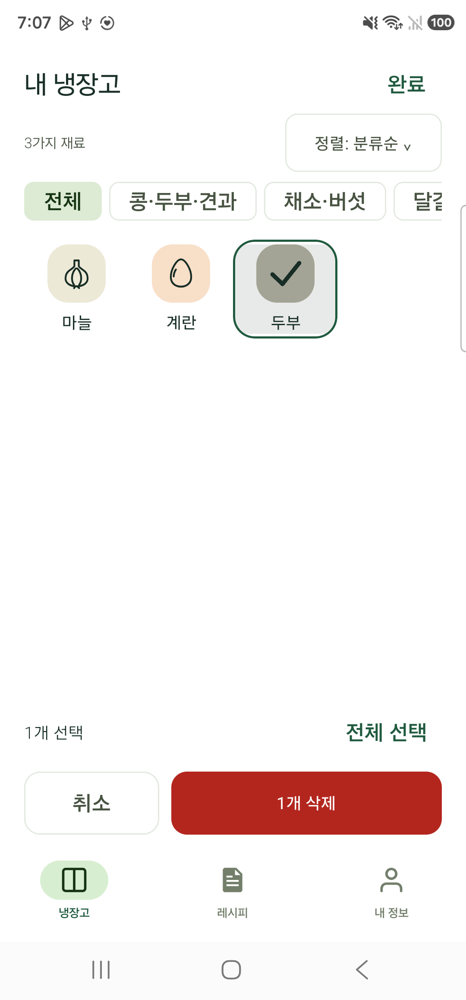
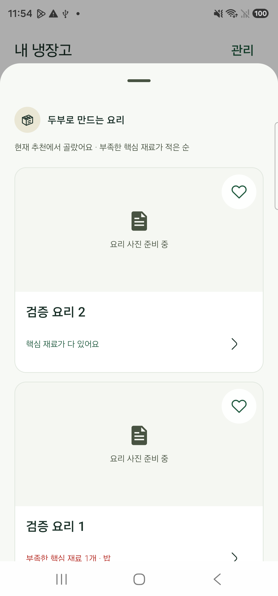
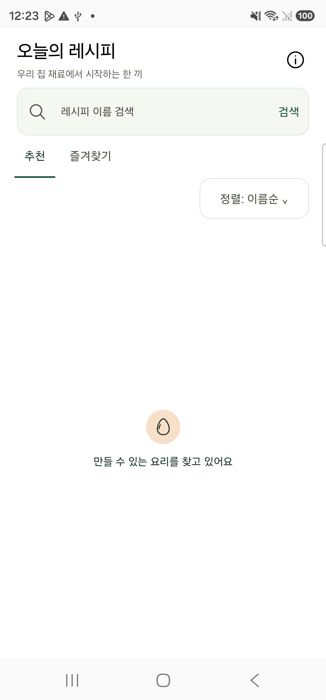

# HE and UAT client improvements

This change applies evaluation feedback to the existing fridge, recipe and profile flows. It keeps the current server API and local user data format.

## What changed

| Area | Behavior to review |
| --- | --- |
| Fridge additions | Recommended ingredients use the existing ingredient icons/colors. Successful local saves show an actionable snackbar inside the open sheet. Duplicate additions show the actual owned state. Undo removes only the item owned by that addition, preserving later changes; save failures offer retry. |
| Fridge navigation | Leaving the fridge clears management mode, temporary selection and open sheets. Inventory and sorting preferences stay intact. Selection controls sit below the grid, so entering management does not move the ingredient tiles. |
| Selection | A selected ingredient shows a check inside its own icon area with a darker background and accessibility state. Long-press and drag consistently select or clear each crossed item once; normal taps and scrolling remain available. |
| Ingredient recipes | A normal fridge tap opens matching received recommendations in a bottom sheet, ordered by missing key-ingredient count. Long-press still enters management. Cards navigate to the shared recipe detail flow. |
| Recipe refresh | Pull down from the top of recommendations to reload. While waiting, hide the cards and show centered ingredient loading. Display eight candidates, preferring unseen ones on refresh; search and ingredient sheets use the whole received response. Restore the previous list after failure and show honest feedback when the candidate set cannot change. |
| Request feedback | Shared task-specific loading uses existing icons with a light fade. It respects reduced animation settings and stops cycling in the background. Its presentation does not trigger API requests. |
| Recipe detail | Copy ingredients or cooking instructions from the currently shown original/revised version only after a tap. Preserve quantities, units and step order as provided. Group AI changes and keep summaries short, with expandable details and animated disclosure. |
| Cooking | Keep the full recipe view and offer step cards with entrance/transition animation, gradually darker step colors and reachable navigation. A missing-ingredient original asks whether to review an AI proposal or continue with the original. The last card offers explicit consumed-ingredient selection and existing save/undo recovery; nothing is preselected or automatically depleted. |
| AI failures | Keep server-reported refusal separate from invalid generated output. Show missing ingredients from the original when relevant; do not relabel every validation failure as an inventory problem or promise that buying the listed items guarantees a valid revision. |
| Camera | General screens are portrait. Only capture supports portrait and both landscape directions, with the shutter on the same device edge. Orientation changes preserve the active camera/sweep; scan results open only after portrait configuration is restored. |
| Initial setup and profile | Onboarding is nickname → basic ingredients/seasonings → start. Remove allergy/utensil settings from profile and guidance. Old stored fields remain for data compatibility, and retired saved navigation routes return to main. |
| Visual guide | Keep the actual-tab guide and replay entry. Measure the current target and fit a scrollable callout into the larger safe area, retaining previous/next/skip controls at large text sizes. |

## Build and run

```powershell
cd android
.\gradlew.bat :app:assembleCloudTest -PserverBaseUrl=http://158.101.141.165/
```

Install `app/build/outputs/apk/cloudTest/app-cloudTest.apk` with `adb install -r` to preserve existing Cloud Test data when the signing certificate matches. Do not uninstall to bypass a signing mismatch. Android Studio must open this checkout's `android/` directory.

The usual CI checks are:

```powershell
.\gradlew.bat lintDebug testDebugUnitTest createDebugUnitTestCoverageReport assembleDebug assembleCloudTest
```

Device-only tests use `:app:assembleCloudTestAndroidTest -PcloudDeviceTest` and the `com.example.mylittlechef.cloudtest.test/androidx.test.runner.AndroidJUnitRunner` runner. The added UAT classes inject fake APIs or temporary stores; camera smoke tests consume their callbacks locally without recognition uploads.

## Review walk-through

1. Open additional ingredient suggestions. Add a new item, undo it, then try an already-owned item. Check snackbar visibility without closing the sheet.
2. Long-press an ingredient, drag across several tiles, and clear them by starting a drag on a selected tile. Check that tile positions do not jump. Switch tabs and return; management should be closed, with inventory and sorting unchanged.
3. Short-tap an ingredient and open a related recipe. Return to recommendations and pull down from the top. Confirm loading-only presentation, candidate changes where alternatives exist, and retry after a connection failure.
4. In detail, copy both sections from original and revised recipes, expand/collapse AI changes, and start cooking. Compare the warning for an original with missing ingredients against a fully held original.
5. Step through cooking, go back, rotate/recreate the view where applicable, and finish. Explicitly select only consumed items; exercise deletion and undo.
6. In capture, rotate in both directions, take portrait/landscape photos and rotate during a video sweep. Confirm portrait results and no reset of the recording mode.
7. Verify the shortened onboarding with a test profile. In profile, confirm only current settings remain and replay the visual guide. Repeat key controls in light/dark mode and at large font size.

## Compatibility and limits

- No backend changes, API extensions, production-server deployment, quantity conversion or expiry tracking are included.
- Ingredient browsing matches normalized names in the current response's key ingredients; it is not an exhaustive database query or an inferred synonym/processing substitution service.
- A card's availability describes key ingredients, not a guarantee that every original recipe ingredient or other cooking condition is satisfied.
- A refresh cannot invent alternative recipes. When the response has too few alternatives, some or all cards can repeat.
- Existing profile fields and old reusable component entry points remain internally for storage/test compatibility, but allergy/utensil collection and settings are no longer exposed by the app.
- Camera layout and capture were checked on a connected SM-S918N. Physical sensor-to-JPEG orientation and tablet/multi-window behavior are separate from direction-request UI checks.
- Screenshots below use synthetic test ingredients/recipes on a phone. They contain no camera input photos or saved user inventory.

## Screenshots

| Fridge selection | Ingredient recipes | Refresh loading |
| --- | --- | --- |
|  |  |  |

## Verification record

- The full Android CI command above passed locally, including lint, unit coverage generation, and Debug/Cloud Test packaging.
- JVM: 165 tests, no failures or errors. Lint: no errors (36 warnings).
- Added UAT suite on the connected SM-S918N: 46 device tests passed in one run. This includes actual screen flows, persistence/undo failure recovery, selection, loading/copying, cooking, the visual guide, portrait/landscape camera capture, and shortened setup/profile.
- Existing Cloud Test preference entries were compared before and after the update/tests and preserved. Original contributor tests/specification references passed the integration-policy check.
- Raw preference snapshots, local build logs, APKs, credentials and environment files stay outside the commit. Server/ARM checks are reported separately by GitHub CI.
