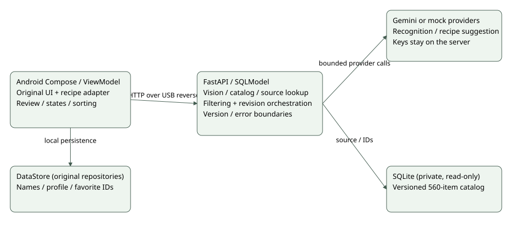
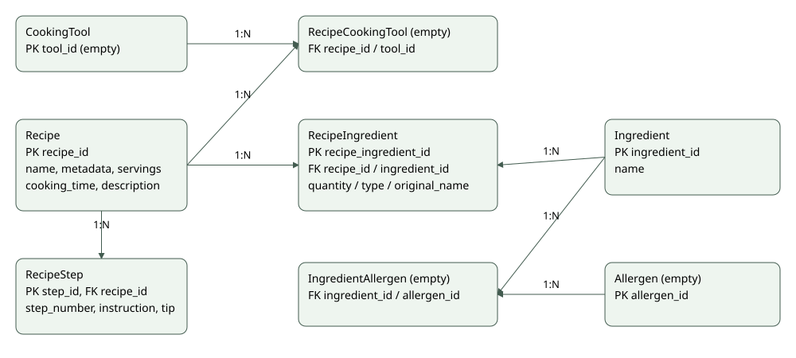

# My Little Chef — Design Documentation

**Team 15 · Iteration 2 · 2026-10-20 · version 0.6 · LOCAL PUBLICATION SOURCE**

## Document Revision History

| Version | Date | Change |
| --- | --- | --- |
| 0.1–0.3 | Through 2026-10-09 | Submitted prototype/architecture discussions retained |
| 0.4–0.5 | October 14–20 | Baseline and branch-boundary drafts |
| 0.6 | 2026-10-20 | Actual integrated architecture, versioning, compatibility and state decisions |

## 1. System Architecture

The Android app runs on a USB phone and FastAPI on the laptop; adb reverse maps phone localhost8000 to the server. Android uses Kotlin, Compose, CameraX, ViewModels, Retrofit/OkHttp/Gson and Hyeokjun's DataStore repositories. Backend uses uv, FastAPI/Pydantic, SQLModel/SQLite, google-genai and Suhyeon's filtering/revision modules. pytest/pytest-cov/ruff, JUnit/AndroidX/JaCoCo and pre-commit support development. python-dotenv is a development dependency for the existing experiment CLI and explicit live checker. minSdk26/target36/compile37, JDK21/Java11 remain unchanged.

Original UI/domain/repositories and author attribution are preserved. New integration modules sit at the canonical-ID, transport and presentation boundaries rather than replacing the original filtering/revision algorithms. Legacy MyLittleChefApi and its tests remain supported; app navigation explicitly injects the new RecipeSource. No fallback silently switches failed new requests to the old staple policy.

## 2. Data and APIs

Recipe has metadata and text servings/cooking_time; RecipeStep holds ordered source instructions/tips; RecipeIngredient preserves repeated ingredient IDs with quantity/type/original labels. Tool/allergen associations are empty. DataStore keeps names/profile/onboarding/favorite IDs; canonical IDs are resolved against the active server catalog instead of being permanently guessed from old IDs.

The new private bundle contains 537 recipes/2870 steps/560 ingredients/5933 relationships. The old701-item runtime is preserved separately. Shared ingredient IDs change meaning, including old204=된장 versus new204=물. The importer/schema for the new bundle removes source URL/step image URL columns. Data rights are not established for redistribution; no private CSV/DB/results are committed. An immutable imported DB is used while serving.

| API | Contract |
| --- | --- |
| POST /analyze | Uploaded photo→unconfirmed names; existing415/422/502/503 distinctions retained |
| GET /recipes/catalog | Ordered ingredient IDs/names and SHA-256 token; rejects the known wrong-water catalog |
| POST /recipes/recommendations | Positive IDs and revision_limit1..5(default 3); original/filtering/revision statuses and summary |
| GET /recipes/source/{id} | Original recipe for favorite restoration, without provider calls |
| POST /recipes/recommend | Preserved legacy name/staple matching API |
| GET /health | Liveness |

The client resolves exact trimmed case-insensitive names, then the existing 달걀→계란 alias only if there is no exact match. Unknown or ambiguous names stay unmapped and are disclosed. It sends X-Ingredient-Catalog; a changed catalog returns409 before revision. Water must actually have the expected meaning. The hash detects catalog differences, not data provenance, schema completeness or cooking safety.

## 3. Algorithms and AI

Suhyeon's policy selects candidates with general matches≥2 or main match≥1. Filtering counts exclude water and resolved seasonings from numerator/denominator; only water is assumed available. No automatic old ten-seasoning assumption or server synonym equivalence is added. Android recommended order uses missing_count, descending matched_count, then recipe ID. Hyeokjun's other sort modes are reused with the filtering count; the full list of absent ingredients remains separate.

Vision mock chooses a recorded response by image hash. Configured Gemini recognition is distinct from that fixture. The app prepares photos to a maximum dimension 2048px, retains selected EXIF and removes GPS; the server forwards the received content. Sample image-token observations do not imply universal constant cost.

Revision uses the original provider interface, prompt/schema and bounded sequential plan. Gemini can use the existing key/model through the documented compatibility endpoint, without replacing the adapter. Default mock revision is a labeled refusal. revised/refused/failed/not_attempted and individual/shared failures remain distinct, including within HTTP200. Structural validation is not semantic repair or allergy/food-safety verification.

## 4. State, concurrency and presentation

The new recommendation client uses read 210seconds/call 240seconds, accommodating default three sequential 60-second calls with transport headroom; automatic transport retry is disabled. Refresh cancels the old coroutine, rethrows cancellation and uses a generation guard so older responses cannot replace current inventory results. This cannot guarantee cancellation of synchronous server/provider work; automatic paid retries are not used.

Loading, empty, unmapped names and transport/server errors are distinct. The existing design is retained, adding only explanatory states, retry and original/suggestion selection. Original text quantities/servings/tips remain readable. Favorites restore source originals without rerunning AI; previous suggestions are not promised after restart. Tools/allergies and reliable serving conversion remain limitations rather than fabricated capabilities.

## 5. Decisions and next iteration

Client-server keeps secrets off the APK and permits independent provider replacement. Versioned runtime mapping preserves the name-based repository and prevents known ID mixing. Separate adapters retain existing contributor interfaces/tests. Explicit source/suggestion views avoid silently substituting AI output for original instructions.

Docker/nginx/deployment stack is deferred to Iteration 3 preparation. Shared deployment, source attribution URLs, metadata-backed constraints, semantic revision evaluation and repeatable AI evaluation remain future work. Detailed pattern documentation is due Iteration 5; current MVVM/repository/provider separation is not presented as completion of that requirement. Testing plans/results are exclusively on the separate Testing page. Official publication and actual main merge have not occurred merely because these sources exist.
