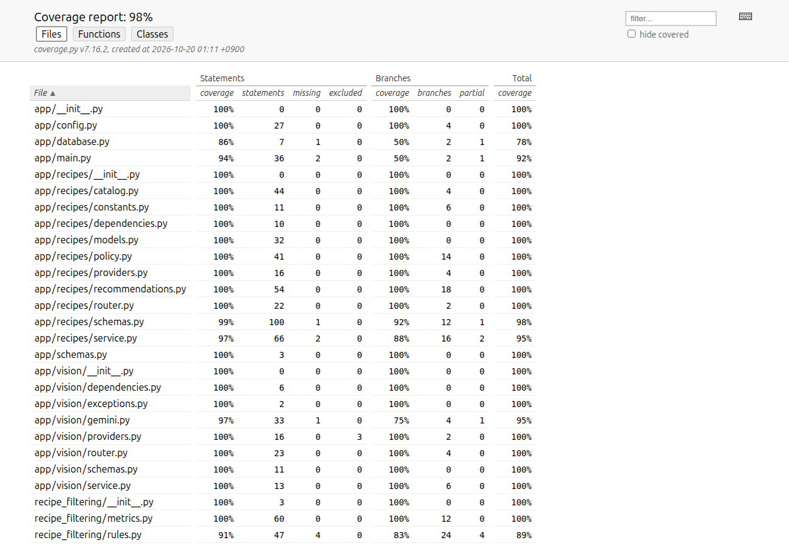
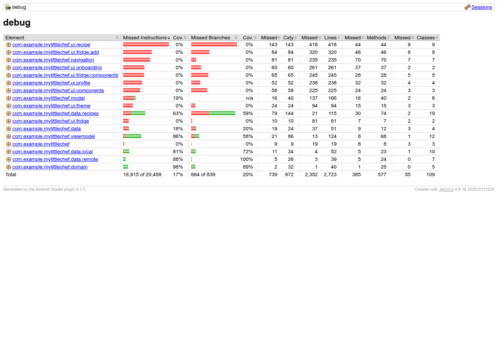

# My Little Chef — Testing Documentation

**Team 15 · Iteration 2 · 2026-10-20 · version 0.4 · LOCAL PUBLICATION SOURCE**

## Document Revision History

| Version | Date | Changes |
| --- | --- | --- |
| 0.1 | October 14 | Initial baseline draft plan/results |
| 0.2 | October 20 | Historical and cached baseline results separated |
| 0.3 | October 20 | Combined branches, flow/state tests, expanded coverage and live/mock evidence |

| 0.4 | October 20 | Fresh-clone setup defect, explicit importer paths and shell-level regression |

## 1. Responsibility and Schedule

### Plan

Existing assignments identify Jaehyuk for API/detection/integration, Hyeokjun for client persistence/sorting and Suhyeon for database/filtering/revision. This page records those inputs; it assigns no new work or numeric coverage goals to teammates. Latest read-only Sheet lists P3/P4/P25/P26 for Jaehyuk and integration tests P28/P30/P32/P34/P35. Unfilled status/worker/effort cells are not fabricated.

Feature unit/regression tests accompany changes. CI runs server lint/format/tests/coverage and Android lint/JVM/JaCoCo/assembleDebug, saving reports/APK. Device tests require an attached target and documented mock backend. After actual review/merge, verify critical flows against the real main SHA. GitHub main was unprotected at inspection; workflow configuration does not enforce branch protection.

### Results

Original contributor test hashes are preserved by a local/CI integrity check. Original commits remain ancestors. Source-level verification and pre-commit have run; exact commit/CI links are finalized in the execution report. Official Wiki posting, actual peer review/merge and submission remain separate actions.

## 2. Unit and Integration

### Plan

Use pytest/TestClient/scripted or stub providers and temporary SQLite for server tests. JUnit4/Gson/coroutines-test and temporary DataStore cover client state/mapping. AndroidX/Compose covers device rendering/actions. CI and ordinary device tests use mock and need no paid keys.

Retain original Jaehyuk draft goals90% vision/API and60% wiring, with deterministic logic versus startup rationale. Before integrated execution, the integration contract added a personal80% combined statement/branch runtime target across app/filtering/revision. This does not replace any submitted plan or set teammate targets. Android layer values are measured without inventing an agreed whole-client target; existing whole-client coverage shortfall remains explicit.

Coverage includes app, recipe_filtering and recipe_revision. pytest now explicitly collects original experiment tests. Experiment CLI/report utilities, importer, research and generated/platform/UI code are outside server runtime coverage; importer/experiment tests are still executed. JVM JaCoCo is not an end-to-end UI coverage measure.

Environment: recorded Python3.13.15/uv, JDK21, Android SDK37, S22 Android14/API34. From repository root:

```sh
(cd server && uv sync --locked)
uv run --project server --locked pre-commit run --all-files
(cd server && uv run --locked pytest --cov --cov-report=term-missing --cov-report=xml --cov-report=html --junitxml=test-results.xml)
(cd android/MyLittleChef && sh ./gradlew --no-configuration-cache lintDebug testDebugUnitTest createDebugUnitTestCoverageReport assembleDebug)
# With both providers=mock, new DB and adb reverse8000:
(cd android/MyLittleChef && sh ./gradlew --no-configuration-cache connectedDebugAndroidTest)
```

A forced `testDebugUnitTest --rerun-tasks` run additionally established fresh JVM results. Preserve human-owned source AC/examples under docs/acceptance; do not alter protected references, weaken tests, delete/skip/ignore tests or report cached runs as fresh. Each changed behavior is listed in the PR.

### Results

| Scope | Target | Actual / measured counts |
| --- | --- | --- |
| Vision/API |90% prior draft |98.37% combined statement/branch |
| Server wiring |60% prior draft |93.59% combined |
| Runtime app/filtering/revision |80% personal integration plan |98% combined; line98.73%, branch94.44%;181 passed |
| Android overall JVM |No agreed numeric target |13.66% lines;34 passed in fresh run |
| Android domain / local repositories |No new team target |97.50% /92.31% lines |
| Android new recipe adapter / ViewModels |No new team target |81.74% /87.69% lines |
| S22 connected |Scenario outcomes |10 passed, including real local HTTP and rendered detail |





All reported tests have0 failed/0 skipped after fixes. Python emits a Starlette deprecation warning and unclosed-connection ResourceWarnings from existing fixtures; tests remain unchanged and warnings are disclosed. Android's DataStore protobuf dependency emits a JVM Unsafe deprecation warning. Overall Android coverage is low because platform/screens are largely outside JVM execution; targeted unit/Compose/device scenarios address integration risks without claiming full UI coverage.

| Scenario / requirement | Executable evidence |
| --- | --- |
| Photo→unconfirmed candidates→reviewed names→catalog→recommendations→original detail; US02/03/04/05 |test_catalog_flow.py, RecipeContractTest, IntegratedBackendFlowTest |
| Mixed statuses, individual/shared failures and request-scoped recovery; NFR05 |Suhyeon's test_recommendations.py/test_revision_failures.py retained; typed client fixture |
| Unknown/duplicate/ambiguous names and stale catalog; US02/04 |Catalog resolver tests, mismatch/no-provider server checks |
| Add/remove/dedup and real store reopen; US01/03/06 |Original tests plus RepositoryReopenTest closing/joining first store |
| Refresh→sort→error→retry→favorite original; US04/06 |RecipeFlowTest; favorite lookup makes no AI call |
| Slow old request/cancellation versus newer inventory; NFR05/06 |Controlled deferred responses and generation-guard test |
| Original/suggestion toggle and refusal; US05/NFR03 |RecipeDetailFlowTest, synthetic fixture |
| Empty/error recognition, upload size/EXIF |Original provider/router/upload tests retained |

A new UI status assertion initially used the assertion's default exact-match semantics with a partial string. It was corrected to the full expected text and the whole connected suite rerun. No original assertion was weakened or test skipped. Offline build initially lacked the existing DataStore dependency; fetching that declared dependency resolved it. Pre-commit cwd was corrected to match CI without reformatting contributor tests.

Actual live checks reuse the existing Gemini key/model within the user-authorized free quota. Recorded recognition and one-candidate adjustment requests returned200; missing identity-defining ingredients produced explicit refusals. This is supported behavior, not a successful-cooking or semantic-quality measurement. Scripted confirmation and actual manual phone navigation are distinguished in the execution report. Exact results/screenshots and call counts remain local/private where they include recipe data.

Pending gaps: complete allergy/tool constraints, source URLs/one-serving conversion, full UI deletion/UAT, server-side cancellation and population usability. Actual merged-main verification remains pending review/merge. Historical baseline33/95%, cached8 and previous device3 results are not reused as integrated results.

## 3. AI Module Testing — Iteration 3

Prepare and commit≥30 frozen cases and thresholds before formal results. Current exploratory11-photo/26-label observations and live smoke checks do not satisfy that formal evaluation. Record model/settings/prompt/label sources and semantic failure analysis; revised status alone is not correctness.

## 4. Acceptance Testing

Plan Iteration 3; results Iteration 4. Existing stories remain human-owned; no completed UAT claimed.

## 5. Alpha/Beta

Iteration 5. No completed alpha/beta claimed.

The first remote fresh clone999c79a failed before app installation because the launcher omitted importer path arguments. The original importer remains unchanged; the launcher now passes the separate CSV/DB paths. test_demo_launcher.py runs the real shell/importer with synthetic CSVs and stub platform tools, preserves a legacy DB sentinel and verifies idempotent rerun. This case increases the local total from180 to181; final corrected-clone evidence is recorded separately.
